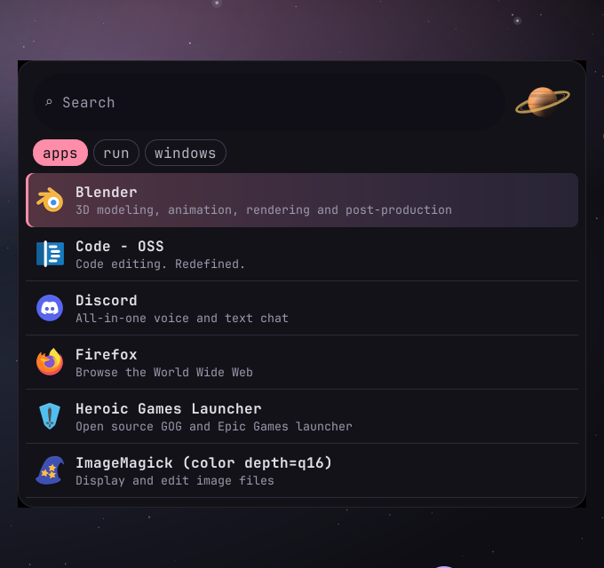
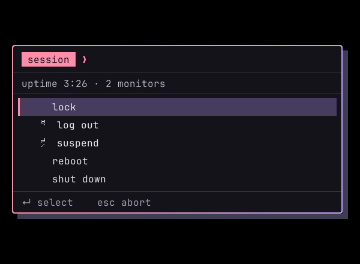
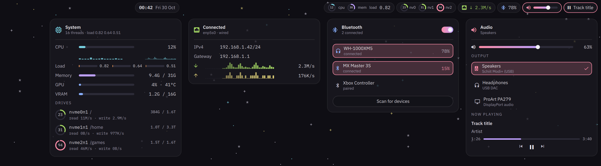

# claude-RICE-hyprland

A complete, soft-dark, space-themed Hyprland desktop for **vanilla Arch Linux**, built around
**Hyprland + kitty + zsh**. One command to install, one palette file to theme everything.

> [!WARNING]
> **Pre-alpha. The installer does not exist yet.** This repository currently contains the
> design foundation: knowledge base, color scheme proposals and palette tooling. Do not expect
> `./install.sh` to work until the Status section says so.

## Status

| Phase | Scope | State |
| --- | --- | --- |
| 0. Foundation | knowledge base, `CLAUDE.md`, README, palette + contrast tooling, launcher concepts | **done** |
| 1. Core | `install.sh` (preflight, packages, backup, deploy), Hyprland Lua config, kitty, zsh, theme generator | **in progress**: theme generator, rofi themes, keybindings, menu script, monitor + layer rules done |
| 2. Desktop | bar, launcher, notifications, hyprlock, hypridle, wallpaper, screenshots, clipboard | **started**: Quickshell bar (Orbit Glass) and live ASCII sky written and render-tested off-hardware; not yet run on a real Quickshell |
| 3. Polish | GTK/Qt theming, cursor, theme switcher, uninstaller, CI in an Arch container | planned |

## Planned usage

```sh
sudo pacman -S --needed git
git clone https://github.com/BattlestarSC/claude-RICE-hyprland.git
cd claude-RICE-hyprland
./install.sh
```

What the installer will do, in order:

1. **Preflight:** confirm Arch, non-root user, working `sudo`, network, no pacman lock;
   detect GPU vendor and VM; refuse Hyprland < 0.57.
2. **Show the plan:** full package list and every file it will place. One confirmation.
3. **Install packages** from official repositories only, in a single `pacman -Syu --needed` transaction.
4. **Back up** any existing config it would replace to `~/.local/state/<rice>/backups/<timestamp>/`.
5. **Deploy** dotfiles and the selected theme.
6. **Optional, each prompted:** set zsh as login shell, enable the greetd login screen, capture your monitors' EDID
   descriptions into the monitor config, Blender GPU rendering (ROCm/HIP, several GB), NVIDIA notes.
7. Log everything to `~/.local/state/<rice>/install-<timestamp>.log`.

Re-running is safe. Your own tweaks go in override files (`~/.config/hypr/local.lua`,
`~/.config/zsh/local.zsh`) that the installer never touches.

## Requirements

- Arch Linux (vanilla install), x86_64, systemd.
- A regular user with `sudo`.
- A GPU with working DRM/KMS. Developed and tested on **AMD**; Intel should work. **NVIDIA**
  needs extra setup (the installer will detect and point you to it). **VMs** need 3D
  acceleration enabled, or Hyprland will not start.
- Multi-monitor setups behind a KVM are a first-class case: monitors are matched by EDID
  description and workspaces return to their monitor after a switch
  ([details](docs/knowledge-base/hardware.md#kvm-hot-unplug-what-hyprland-057-does)).
- Hyprland **0.57 or newer**. This rice uses the Lua config format, which is the only format
  0.57 supports. Configs written for older Hyprland (`hyprland.conf`) do not work here and vice versa.

## Components (planned)

| Role | Choice | Notes |
| --- | --- | --- |
| Compositor | Hyprland ≥ 0.57 | Lua config, split into modules |
| Terminal | kitty | auto-reloads config; colors in a generated `theme.conf` |
| Shell | zsh + starship | no framework; autosuggestions, syntax highlighting, fzf, zoxide |
| Lock / idle | hyprlock, hypridle | |
| Wallpaper | **live ASCII Earth + Moon** (Quickshell, two GPU shader passes, 10 fps, both monitors in sync, pauses under fullscreen) | [D15](docs/decisions.md#d15-wallpaper-live-ascii-earth-and-moon-gpu-shaders-in-quickshell-owner-2026-10-30) |
| Login | greetd + ReGreet, inside Hyprland | same monitor config as the desktop; no X server |
| Bar | Quickshell, **Orbit Glass**: CPU/memory/load, GPU, per-drive disks, network, Bluetooth, volume + output picker, media | [render](docs/bar/renders/orbit-glass.png), [D14](docs/decisions.md#d14-bar-quickshell-orbit-glass-design-owners-call-2026-10-30) |
| Launcher + menus | rofi 2.x: **Orbit** (apps, `$mod+d`) and **Flight Deck** (all scripted menus) | [concepts](docs/launcher/concepts.html) |
| Keybindings | i3 defaults (`$mod` = Super, `j k l ;`) | [docs/keybindings.md](docs/keybindings.md) |
| Static art | generated from the palette (`tools/spacegen.py`), incl. an Orbiter-style ASCII scene | lock and login screens |
| Notifications | mako (proposed) | [O5](docs/decisions.md#o5-notifications) |
| Blender GPU | ROCm / HIP (`hip-runtime-amd`, `hiprt`) | opt-in |
| Portals | xdg-desktop-portal-hyprland + -gtk | screen sharing, file picker |
| Polkit | hyprpolkitagent | |
| Audio | PipeWire + WirePlumber | |
| Bluetooth | BlueZ, controlled from the bar | power, scan, connect, device battery |

## Launcher and menus

Real renders of the generated rofi themes (`tests/rofi-render.sh`: rofi under Xvfb, so the
translucent corners show black and there is no blur; on Hyprland the panel is frosted glass).

| Orbit: apps (`$mod+d`) | Flight Deck: scripted menus (`$mod+Shift+e`) |
| --- | --- |
|  |  |

## Bar

Orbit Glass, rendered from the real QML with sample data (`tests/quickshell/render.py`; no blur
off-compositor). Dropdowns: System, Network, Bluetooth, Audio.



## Color scheme

Soft dark, space-tinted, Monokai-derived. Chosen palette: **Quasar**, a blend of round 1's
Pulsar (dark, saturated) and Event Horizon (soft), checked with two contrast models:

- WCAG 2 ratios (accessibility baseline): body text 13.5:1, comments 6.4:1, every accent ≥ 8:1.
- APCA (perceptual, catches dark-mode glare): body text Lc 88 (glare starts above ~92), accents
  held within Lc 58–74 so no token glares or recedes.

- Rationale, rules, roles, ANSI and syntax mappings: [docs/colors/proposals.md](docs/colors/proposals.md)
- Visual comparison with a **live blend dial**: open [docs/colors/preview.html](docs/colors/preview.html) in a browser.
- Try a palette in your current kitty now: each palette on the preview page has a copy-ready `kitty.conf` block.

## Repository layout

```text
CLAUDE.md                 guidance for AI-assisted development (rules, conventions, commands)
bin/rice-menu             scripted menus (session, clipboard, windows, keys, screenshot)
bin/rice-sky-atlas        renders the ASCII sky's glyph atlas at a monitor's exact cell size
colors/
├── quasar.toml           the palette: single source of truth for every app theme
└── proposals/            design history (round 1 palettes, round 2 Quasar)
config/                   dotfiles as deployed under ~/.config (rofi/, quickshell/, hypr/conf/ so far)
assets/earth/             Earth land mask for the ASCII sky (from Natural Earth, public domain)
templates/ → themes/quasar/   per-app color templates and their generated output
docs/
├── colors/               proposals.md, preview.html (generated, includes the blend dial)
├── launcher/             concepts.html (generated rofi launcher concepts)
├── decisions.md          decided architecture + open questions
└── knowledge-base/       verified notes: Hyprland 0.57 Lua, hypr tools, Arch, hardware/KVM, rofi, kitty, zsh, theming
tools/                    dev only (Python 3.11+); the installer never uses these
├── palette.py            color math, WCAG + APCA contrast rules, reports
├── blend.py              OKLCH blend of two palettes, normalized to the rules
├── preview.py            renders docs/colors/preview.html
├── launcher_preview.py   renders docs/launcher/concepts.html
├── spacegen.py           palette-colored space art (SVG): wallpaper, starfields, planets
├── earthmask.py          Natural Earth GeoJSON → equirectangular land mask PNG
└── render_theme.py       templates/ → themes/<palette>/ (with --check for drift)
tests/                    rofi-render.sh (real rofi screenshots), lua/ (Hyprland API stub, bind tests),
                          quickshell/ (bar render, mock services), sky/ (ASCII sky frames + timing)
```

The target layout for later phases is in [CLAUDE.md](CLAUDE.md#repository-layout-target-create-directories-as-phases-need-them).

## Documentation

| Doc | For |
| --- | --- |
| [docs/knowledge-base/](docs/knowledge-base/README.md) | how things work and what was verified where |
| [docs/knowledge-base/hyprland.md](docs/knowledge-base/hyprland.md) | Hyprland 0.57 Lua config, pitfalls, hyprctl changes |
| [docs/decisions.md](docs/decisions.md) | why things are the way they are; what is still open |
| [docs/keybindings.md](docs/keybindings.md) | the i3 keymap on Hyprland, bind by bind |
| [docs/colors/proposals.md](docs/colors/proposals.md) | palette design and selection |
| [docs/knowledge-base/hardware.md](docs/knowledge-base/hardware.md) | dual 4K via KVM, AMD + ROCm, SDDM |
| [docs/knowledge-base/launcher.md](docs/knowledge-base/launcher.md) | rofi on Wayland: capabilities and limits |
| [docs/knowledge-base/bar.md](docs/knowledge-base/bar.md) | Quickshell bar and ASCII sky: structure, data sources, tests |

## Development

Dev tools need Python 3.11+ (for `tomllib`). The installer itself will need only bash and git.

```sh
python3 tools/render_theme.py colors/quasar.toml --check
lua5.4 tests/lua/run.lua config/hypr/conf/binds.lua config/hypr/conf/monitors.lua config/hypr/conf/layers.lua
python3 tools/palette.py check colors/quasar.toml
python3 tools/preview.py --standalone colors/proposals/round2/*.toml colors/proposals/round1/*.toml > docs/colors/preview.html
python3 tools/launcher_preview.py --standalone colors/proposals/round2/quasar.toml > docs/launcher/concepts.html
```

## License

Personal project; no license.
